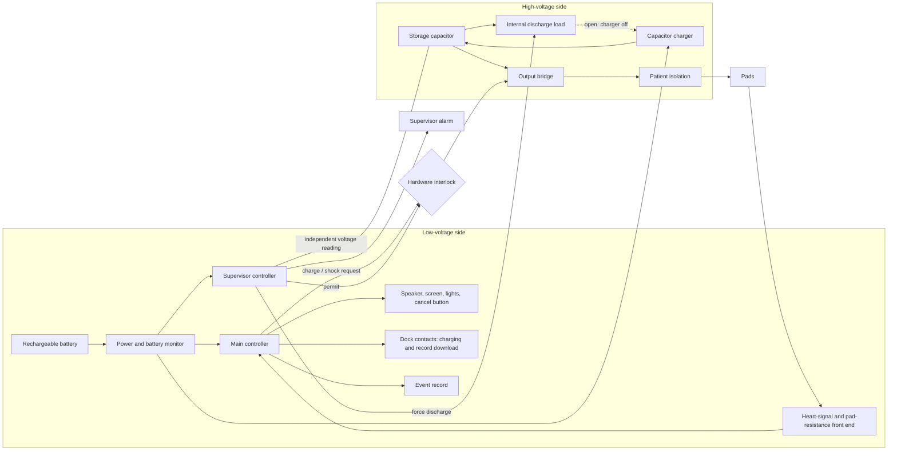
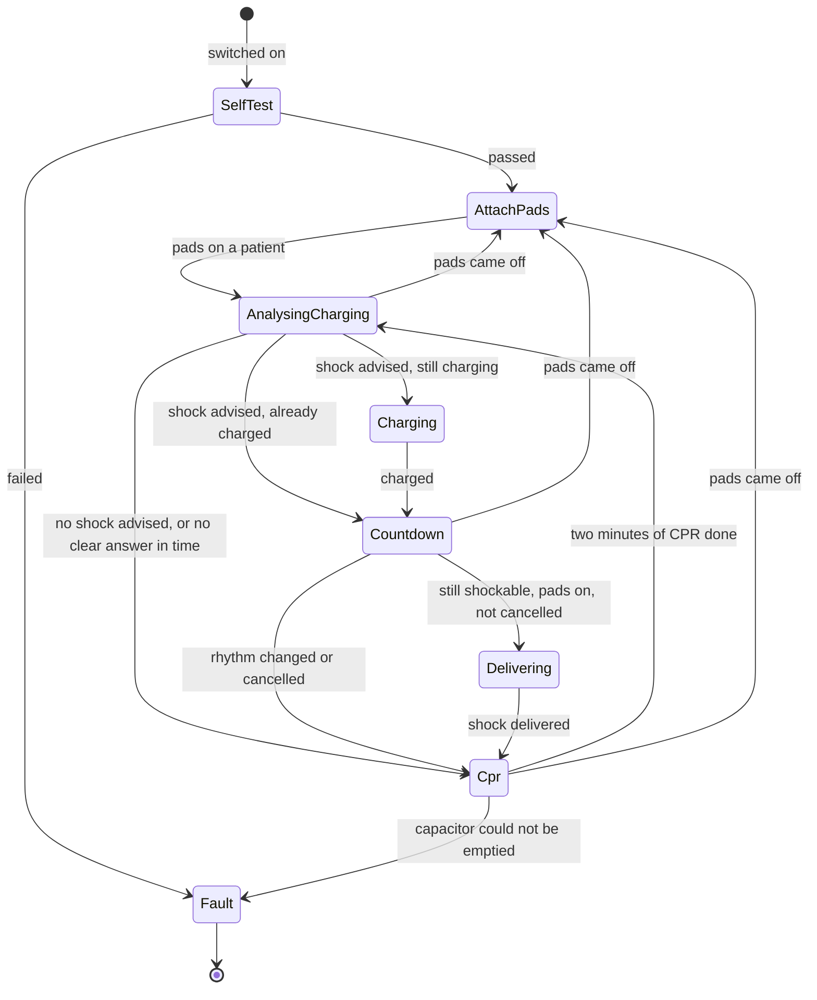

# System architecture

Version 0.6, 27 November 2026. Decision numbers (D-xx) refer to [DECISIONS.md](../DECISIONS.md).

**Everything in this document is a design on paper and in simulation. No hardware exists. Figures marked *model* come from arithmetic, not measurement.**

## The device in blocks

| Block | Job | Notes |
|---|---|---|
| Heart-signal front end | Reads the heart's electrical signal and the resistance between the pads | Off-the-shelf chip; must survive the device's own shock and recover within seconds |
| Main controller | Runs the rescue: analyses the rhythm, charges, counts down, requests the shock, speaks the prompts, keeps the record | Firmware in Rust (D-08) |
| Supervisor controller | A second, separate, much simpler processor that must agree before any shock, and can empty the capacitor on its own | Different chip, own power rail, own voltage reading |
| Hardware interlock | Plain logic, no software: the bridge can fire only when the main controller's request and the supervisor's permit are both present | The third independent check |
| Capacitor charger | Raises battery voltage to about 1,900 volts in under 8 seconds | Starts from a published reference design |
| Storage capacitor | Holds the shock energy: about 100 µF | The largest part in the device |
| Output bridge | Sends the energy to the patient in two phases, forward then reversed, and cuts it off at the planned moment | |
| Internal discharge load | Safely burns off the charge when a shock is cancelled, and stands in for a patient during self-test | Discharges by default: the capacitor is only held charged while the controllers actively hold the discharge path open |
| Patient isolation | Disconnects the high-voltage side from the pads except during the shock itself | |

## Three independent checks before a shock

The device is fully automatic (D-06), so no human presses a button. No single failure, in hardware or software, may deliver a shock that was not advised, or block one that was.

1. **Main controller.** Its rhythm analysis says "shock", the pads are attached, the capacitor is at the planned voltage, the countdown has finished, and cancel has not been pressed.
2. **Supervisor controller.** Checks independently, with its own readings: the capacitor voltage matches what the main controller claims; the pad resistance is in the range for a patient; the main controller is alive (a regular heartbeat signal); the main controller has been in the "armed" state for at least the countdown time; cancel has not been pressed. Only then does it issue a permit, and only for a short window.
3. **Hardware interlock.** The bridge drivers are powered only while both signals are present.

The supervisor also empties the capacitor by itself if: the main controller stops responding; the capacitor stays charged longer than a time limit; the voltage goes above a safe maximum; or the two controllers disagree.

Two further rules came out of simulation (finding F-3):

- **The charger cannot run while the discharge path is open.** Because either controller letting go opens the discharge path, the supervisor can always stop the charger, even if the main controller has frozen with the charger switched on. This is a requirement on the hardware, not something software can provide.
- **The supervisor has its own alarm**, a buzzer or light it alone controls. If the main controller dies it cannot speak, so the supervisor sounds the alarm whenever it has declared a fault, or if the main controller never starts.

What the supervisor does *not* do is second-guess the rhythm. A second opinion on the rhythm is built into the main controller's analysis (two different methods must agree). Whether the supervisor should also run its own simple rhythm check is an open design question.

## The rescue sequence

Points that matter:

- **"Not sure" never leads to a shock.** The analysis may answer shockable, not shockable, or not sure. While analysing, "not sure" means keep analysing and remind the responder not to touch the patient; if the time limit passes without a clear answer the device says so and goes to CPR. Once the capacitor is charged, "not sure" cancels the shock.
- **The rhythm is checked right up to delivery.** During the countdown the analysis keeps running. If the rhythm stops being shockable, the shock is abandoned and the capacitor emptied.
- **Any fault leads to "continue CPR"**, with the capacitor emptied. A faulty device must never leave a responder waiting for it.
- **Cancel works in every state.**
- **The capacitor charges while the rhythm is being analysed** (D-29), so a shock can follow the decision after only the 3-second countdown (D-30). If no shock is advised, the charge is burned off in the internal load.
- **Emptying the capacitor happens in the background.** Whenever a charge is not going to be used, and after every shock, the device lets go of the capacitor and gives the responder the next instruction at once. It then confirms the capacitor is empty, will not start another charge until it is, and raises its most serious fault if it cannot confirm within the limit.
- **The device senses chest compressions through the pads** (D-36). The resistance between the pads swings each time the chest is pressed. The rhythm analysis only looks at the heart signal while the chest is still, and starts a fresh look each time it becomes still. Its filters keep running through CPR so that the fresh look needs only a quarter-second guard, not a full settling second (D-47). After a shock is advised, any sensed movement holds the shock back at once; the device empties the charge and analyses again, once, before falling back to CPR. If the sensing cannot tell, it counts as movement. If the sensing channel fails outright, the device carries on using the heart signal alone and records that it has done so.
- **During CPR the same signal measures** compression rate, pauses and time on the chest, for the record. The only prompt it drives is "Continue CPR" after 15 seconds with no compressions.
- **Pads that are on but making poor contact** (resistance above the range a shock is designed for, up to about 250 ohms) are still analysed, with the prompt "Press pads firmly". A shock is given only if the resistance is in range at the moment of delivery (D-32).
- **Cancel is ignored during the switch-on self-test**, and a cancel button held for 10 seconds is treated as stuck and reported as a fault (D-31).

Timings (CPR period, countdown length, time limits) are settings in one place in the firmware, to be set from the current resuscitation guidelines and the purchased standard, not scattered through the code.

## The shock, in numbers (*model*)

The design point follows D-02 and D-03: a biphasic truncated exponential shock from a single capacitor of about 100 µF.

- The capacitor is charged to a fixed voltage for the chosen mode (adult or child).
- The device measures the resistance between the pads before the shock.
- From that resistance it chooses how long each phase lasts, so that the delivered energy lands on the target: longer for high-resistance patients, shorter for low.
- Starting assumptions, to be replaced by a parameter-by-parameter match to the published Philips waveform: first phase between about 3 and 12 milliseconds; second phase about two-thirds of the first; a short gap between them; total no longer than about 20 milliseconds.

The firmware's waveform module computes the full table (charge voltage, phase times, peak current, delivered energy, for every resistance from 25 to 175 ohms, adult and child) and the tests check it. That table is the specification the high-voltage hardware will later be measured against.

## Firmware structure

The firmware is split so that everything that decides anything can be tested on an ordinary computer, with no device attached.

| Part | What it holds | Runs on |
|---|---|---|
| `aed-types` | The shared vocabulary: units, patient mode, rhythm decision, shock plan | Device and computer |
| `aed-rhythm` | Heart-rhythm analysis | Device and computer |
| `aed-waveform` | Shock planning and the electrical model of the discharge | Device and computer |
| `aed-cpr` | Compression sensing from pad resistance | Device and computer |
| `aed-core` | The rescue sequence, the supervisor's rules, self-test, prompts, event record. Talks to hardware only through a defined interface. | Device and computer |
| `aed-eval`, `aed-cpr-eval` | Score the rhythm analysis and the compression sensing against real recordings (data not included) | Computer only |
| `aed-sim` | A simulated device and patient: plays heart rhythms in, models the capacitor and the patient's resistance, injects faults | Computer only |
| *(later)* board support | The thin layer that connects `aed-core` to a real processor's pins | Device only |

Rules for the firmware:

- No hardware-specific code outside the board-support layer. The processor is not chosen yet (the Rust compiler qualification question is unresolved), and this keeps that choice open.
- No dynamic memory, no unsafe code, and no code path that can crash in the parts that run on the device.
- The main controller and the supervisor are written as separate pieces that share no state, even in simulation, so the simulation can test what happens when one of them fails.
- Every safety rule in this document has a test that names it.
- Third-party code is kept to the minimum. Each addition is listed with the reason, because the medical software standard requires every outside component to be justified and tracked.

## Self-testing while idle

The device tests itself on a schedule (D-15): a full-energy charge into the internal test load once a week, and a low-voltage check every day. The schedule uses only elapsed time, never the time of day, so a clock fault cannot silently skip tests. A failed or badly overdue test shows "not ready". Every full-energy charge is counted, from tests and from rescues, so capacitor wear is visible in the record. A device showing "not ready" still attempts a rescue: its switch-on self-test decides whether it may shock (D-50).

## Heat

The device watches its own temperature at all times, including when switched off (D-48). The pads and the battery, not the capacitor, set the limits.

- **Six temperature points:** each battery cell, the capacitor, the pads, the circuit board, and a second sensor on the capacitor that only the supervisor reads. A reading that is missing, impossible, stuck, or far from the others is not trusted, and a distrusted sensor makes the device "not ready".
- **States:** normal up to 40 °C; warm from 40 to 60 °C, still ready for up to 8 hours at a time; too hot above 60 °C, "not ready" until every sensor has been below 45 °C for half an hour and a self-test has passed; service needed if anything ever reads above 70 °C.
- **While off** it wakes every five minutes (every minute when warm), takes the readings, and keeps 90 days of hourly history plus lifetime totals. A gap in that history means the temperature was unknown, so the device is "not ready" until a self-test passes.
- **Charging limits:** the battery charges on the dock only between 0 and 45 °C. The capacitor is charged only when it and the cells are at or below 60 °C. Above 55 °C the device stops charging during the analysis and charges only once a shock is advised, so that a long rescue on a hot day cannot heat itself past the limit.
- **A rescue while too hot (D-51):** the device guides CPR and analyses as usual but does not charge. If a shock is advised it says so, says it is too hot, and returns to CPR at once. It checks again at each analysis and shocks normally once it has cooled. It never charges during CPR.
- **The supervisor checks independently:** if its own sensor reads above 65 °C it releases the capacitor and refuses a permit. A missing reading, or one far above what the main controller reports, is ignored and recorded, so a broken supervisor sensor cannot block every shock.
- **Pads (D-52):** time spent above 50 °C is added up for each pad set, and after about 7 days in total the device calls for new pads.
- **Capacitor wear (D-53):** every full charge is counted. "Service soon" at 90% of the 2,500-charge life; "service due" at 100%, which shows "not ready" but never stops the device shocking.

All of this survives the battery being removed. Every figure is provisional until the real parts are chosen.

## Reading the record

There is no radio in the first prototype (D-09). The event record, heat history, counters and readiness come off by cable through the dock contacts, as plain text with a version line and a checksum. A reader on a computer prints it in plain English.

## What is deliberately not designed yet

- Final part choices. Candidate parts are named in [HARDWARE_DESIGN.md](HARDWARE_DESIGN.md) and [PARTS_STUDY.md](PARTS_STUDY.md); none has been tested.
- A reviewed circuit design. The first circuit design is being drawn in `hardware/` and specified in [HARDWARE_DESIGN.md](HARDWARE_DESIGN.md); it is unreviewed and marked not for construction (D-13).
- Pads, enclosure, battery pack.
